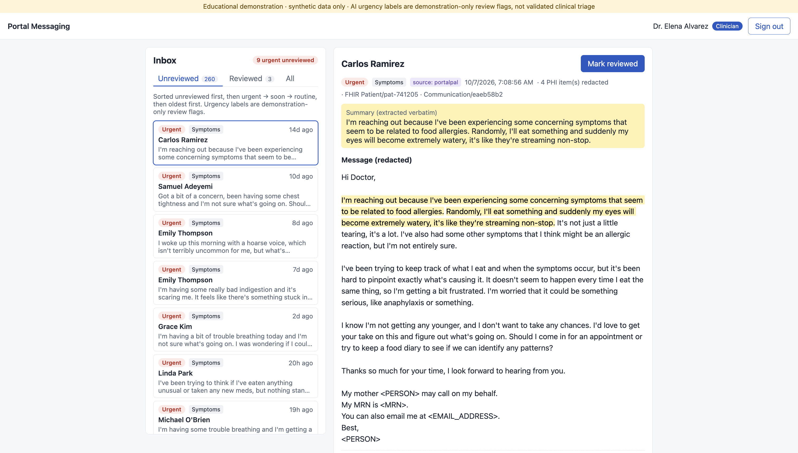
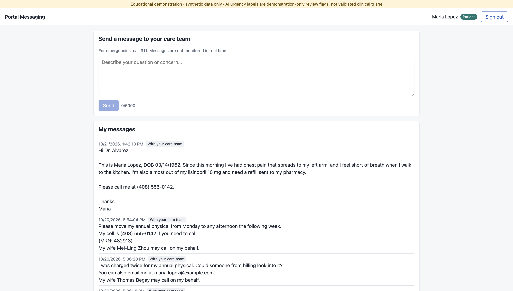
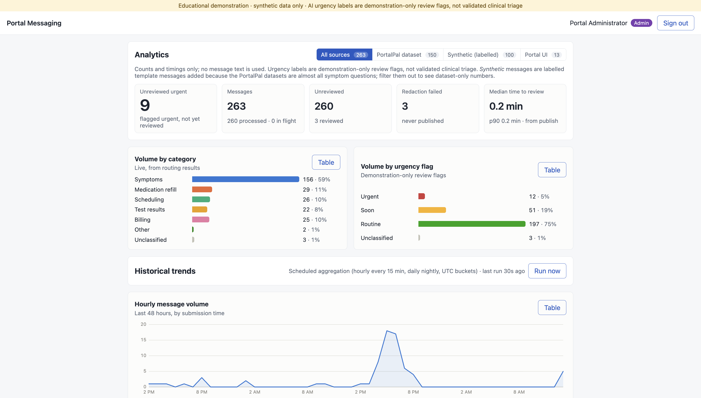
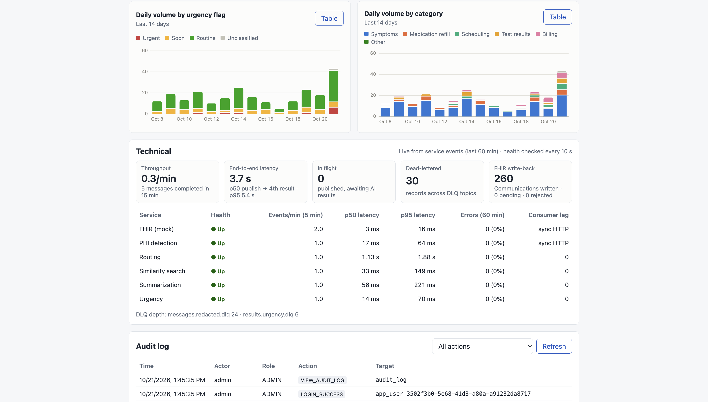
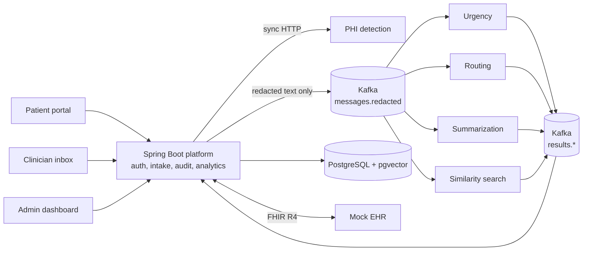

# AI Patient Portal Messaging Platform

CMPE 272 Final Project

An event-driven healthcare messaging platform that redacts protected health information (PHI) from patient portal messages, then uses five locally hosted AI microservices to flag urgency, route each message to the right team, summarize it, and surface similar past messages for clinicians.

> **Educational demonstration only.** All patient data is synthetic. Urgency flags are demo-only review aids, not validated clinical triage.



## Highlights

- **Event-driven microservices:** a Spring Boot platform and five Python AI services communicate through Apache Kafka, with idempotent consumers, retries, and dead-letter topics.
- **PHI-first privacy design:** every message is redacted before it reaches Kafka. Unredacted text lives in one restricted table, protected by role-based access, audit logging, and least-privilege database roles.
- **Horizontal scaling:** running three replicas of the bottleneck routing service across Kafka partitions gave **2.15× throughput**, with **1,000 load-test messages and zero errors**.
- **Healthcare interoperability:** integrates with a simulated EHR through **HL7 FHIR R4**, writing each processed message back as a redacted `Communication` resource.
- **Fully local AI:** all inference runs on CPU in Docker with pretrained models. No external LLM APIs, no training, no paid services.
- **Tested end to end:** **143 automated tests** and **50 live end-to-end checks**, with GitHub Actions CI on every push.

## Screenshots

| Patient portal | Clinician inbox |
|---|---|
|  |  |

| Analytics dashboard | Analytics dashboard (detail) |
|---|---|
|  |  |

## Architecture



1. A patient submits a message through the portal.
2. The platform calls the PHI service synchronously. If redaction fails, the message is marked `REDACTION_FAILED` and never published.
3. The redacted message is published to Kafka, where four AI services process it in parallel.
4. The platform stores the results, sorts the clinician inbox by urgency, and writes the message back to the mock EHR via FHIR.
5. Every service call emits an event that feeds live metrics and scheduled hourly and daily aggregates on the dashboard.

## AI Microservices

| Service | Approach | Warm latency |
|---|---|---|
| PHI detection | Microsoft Presidio + spaCy + custom recognizers | ~13 ms |
| Urgency flagging | Red-flag rules with negation handling (negspaCy) | ~8 ms |
| Message routing | DeBERTa-v3 zero-shot classification | ~1.1 s |
| Summarization | Extractive, using MiniLM sentence embeddings | ~57 ms |
| Similarity search | MiniLM embeddings + pgvector | ~40 ms |

Routing reached **93/100 accuracy** on a labeled synthetic test set. The similarity threshold (0.52) was tuned from the data and reaches 97% precision.

## Tech Stack

- **Backend:** Java 21, Spring Boot 3, Spring Security (JWT), HAPI FHIR R4
- **AI services:** Python 3.11, FastAPI, PyTorch, Hugging Face Transformers, spaCy, Presidio
- **Data and messaging:** Apache Kafka (KRaft), PostgreSQL 16, pgvector, Flyway
- **Frontend:** React, Vite
- **Infrastructure and testing:** Docker Compose, GitHub Actions, JUnit, Testcontainers, pytest, k6

## Load Test Results

500 messages per run with k6, all accepted with zero errors:

| Routing replicas | Throughput | Speedup |
|---|---|---|
| 1 | 0.63 msg/s | 1.00× |
| 3 | 1.36 msg/s | 2.15× |

## Challenges and Lessons Learned

- **Testing beyond mocks:** A birth date escaped PHI redaction because Presidio matched context against word roots (`born` → `bear`). Correcting the context terms and adding real-model regression tests reinforced the need to validate privacy controls against actual model behavior.
- **Handling language edge cases:** Negation incorrectly carried across clauses. Sentence boundaries and stop words such as “just” and “only” prevented unrelated symptoms from being marked as negated.
- **Recovering from service failures:** Container restarts left stale HTTP connections. A single retry for connection failures improved recovery, while regression tests caught a timeout-handling issue introduced by the fix.
- **Measuring before optimizing:** A CPU-based threading formula reduced throughput from 0.64 to 0.47 messages/sec. Benchmarking identified two threads per replica as the fastest configuration.
- **Evaluating data coverage:** Roughly 98% of source messages concerned symptoms. Clearly labeled synthetic examples expanded category coverage and provided a routing evaluation set.

## Run Locally

Requires Docker Desktop with at least 8 GB of memory allocated.

```bash
cp .env.example .env
```

Fill in the values in `.env`, then start the app:

```bash
docker compose up -d --build
```

Open http://localhost:3000 and sign in as `admin`, `dr.alvarez`, or `maria.lopez`, using the `DEMO_USER_PASSWORD` set in `.env`.

## Data and Attribution

Patient messages come from the [PortalPal-AI](https://huggingface.co/PortalPal-AI) datasets by the Persist Lab at Dartmouth College (CC BY-NC 4.0), supplemented by clearly labeled synthetic messages. Fake identities use reserved phone ranges and `example.com` addresses. No real patient data is used.

## License

MIT
